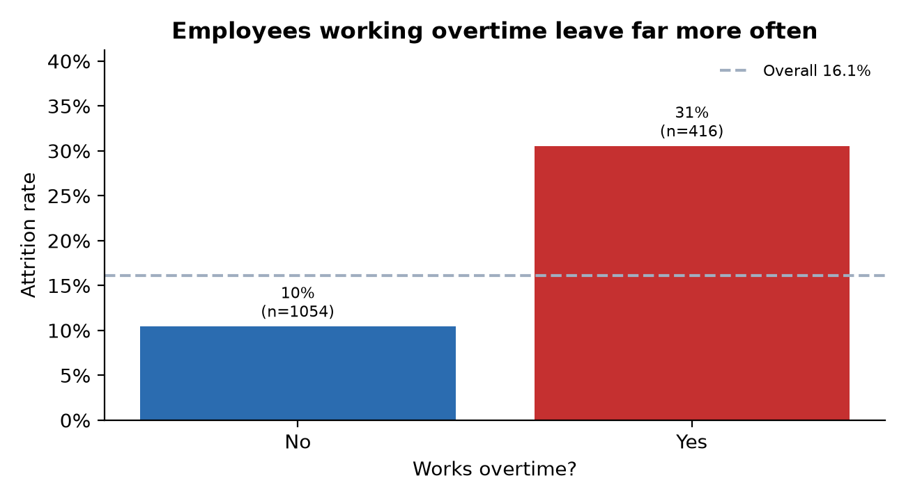
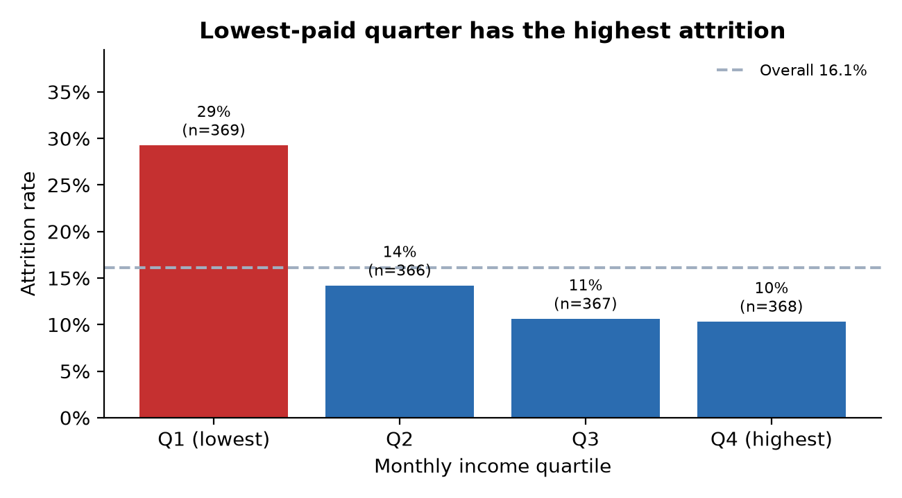
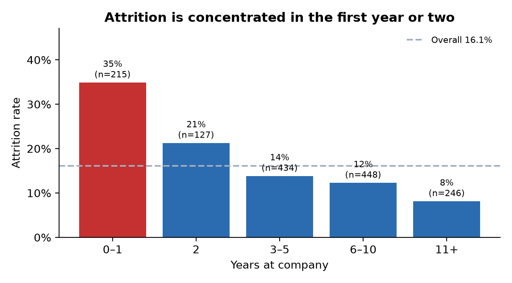
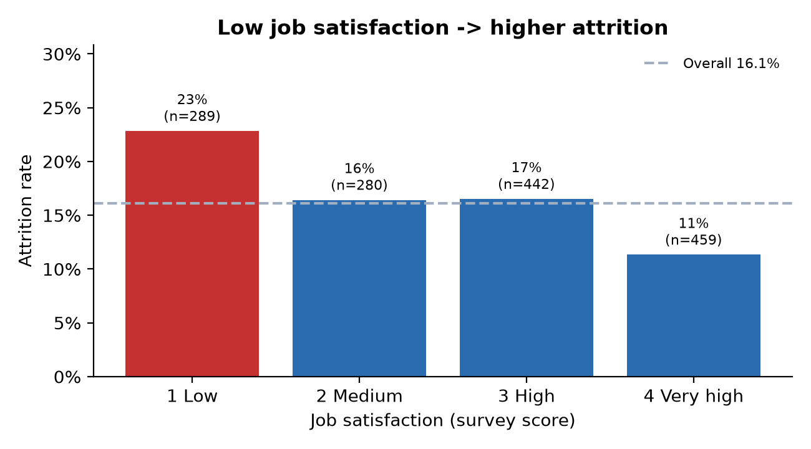
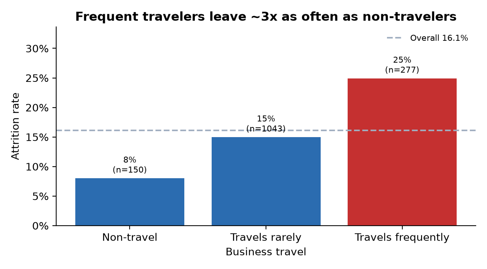
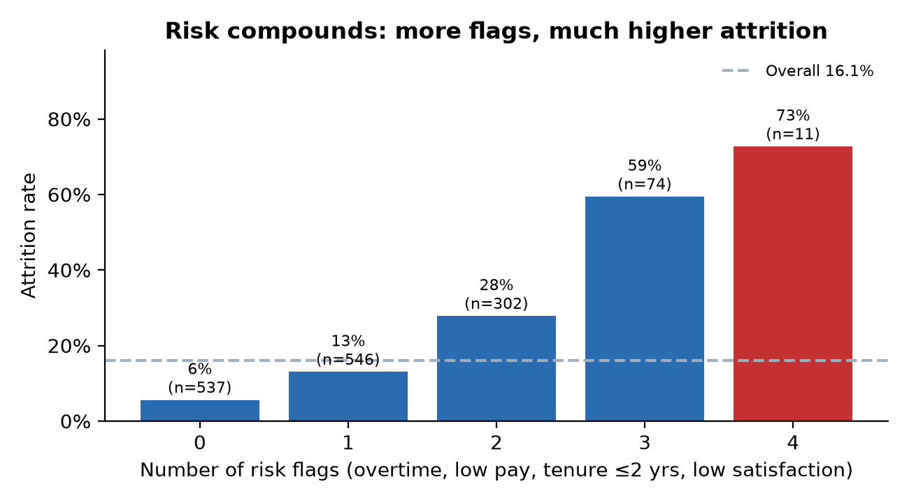
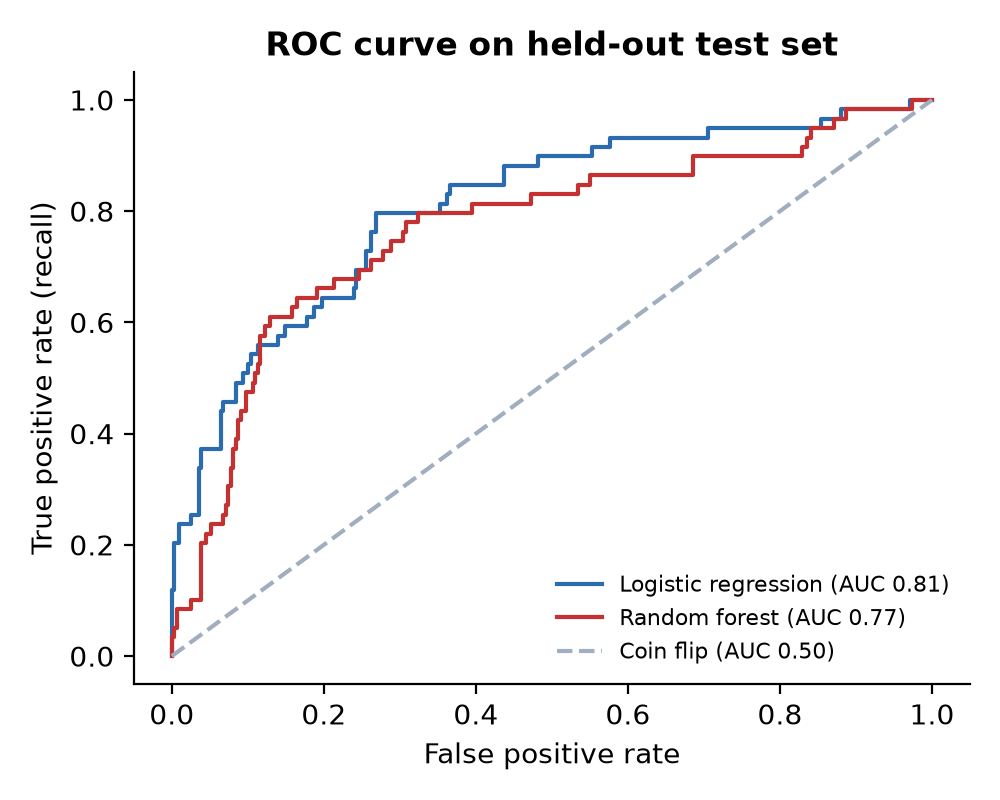
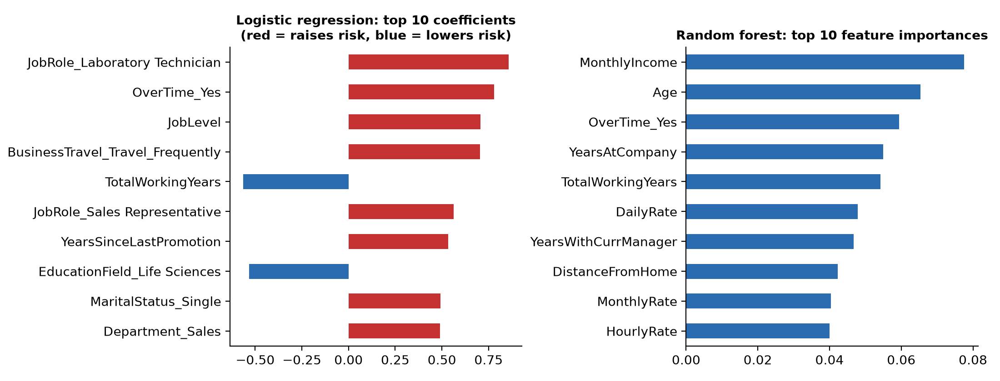

# Employee Attrition Risk Explorer
**A People Analytics + AI consulting mini-case by [Ryan Le](https://www.linkedin.com/in/ryan-le16)** (UNC Kenan-Flagler, BSBA Business Administration + Data Science)

**Question:** Which employees are most likely to leave, why, and what should the company do about it?

## What's inside
| File | What it is |
|---|---|
| `Employee_Attrition_Risk_Explorer.ipynb` | The full analysis (Python notebook, already run with all outputs saved). Opens in Google Colab. |
| [Employee_Attrition_Risk_Explorer_Summary.pdf](./Employee_Attrition_Risk_Explorer_Summary.pdf) | 2-page executive summary: problem, approach, findings, recommendations. |
| `IBM_HR_Employee_Attrition.csv` | The dataset (1,470 rows × 35 columns). |
| `figures/` | Key charts from the analysis (overtime, income, tenure, satisfaction, travel, risk flags, ROC, feature importance). |

## Approach
1. **Explore (EDA):** attrition rates by overtime, income quartile, tenure, job satisfaction, business travel, and number of stacked risk flags (6 charts).
2. **Predict:** logistic regression vs. random forest (scikit-learn), 75/25 stratified train/test split, class-balanced; evaluated with accuracy, ROC-AUC, and recall; feature importance for both.
3. **Recommend:** 4 retention actions written as product briefs (user → problem → solution → success metric) with transparent impact estimates, plus an "Attrition Risk Watchlist" built from the model.

## Headline results (from the saved notebook run)
- Overall attrition: **16.1%** (237 of 1,470).
- Overtime workers left at **30.5%** vs **10.4%** for others (2.9x).
- First year at the company: **34.9%** attrition; lowest income quartile: **29.3%** (vs 10.3% highest); frequent travelers **24.9%** vs 8.0% non-travelers.
- 0 risk flags → **5.6%** attrition; 3 flags → **59.5%**.
- Logistic regression: **ROC-AUC 0.81**, recall 64%, accuracy 77.7%. Random forest: ROC-AUC 0.77, recall 42%, accuracy 83.4%. (Always guessing "stays" = 84.0% accuracy, which is why recall and AUC matter more.)
- Top-20% risk watchlist caught **56%** of actual leavers in the test set (33 of 59).

## Key figures

## How to run
- **Colab:** open the notebook, then *Runtime → Run all*. If the CSV isn't next to the notebook, it downloads automatically from IBM's GitHub.
- **Locally:** `pip install pandas scikit-learn matplotlib jupyter` then `jupyter notebook Employee_Attrition_Risk_Explorer.ipynb`.

## Data source & note
IBM HR Analytics Employee Attrition & Performance sample dataset, from IBM's GitHub repo
[IBM/employee-attrition-aif360](https://github.com/IBM/employee-attrition-aif360) (`data/emp_attrition.csv`); also widely shared on Kaggle as `WA_Fn-UseC_-HR-Employee-Attrition.csv`.
**The employees are fictional**: IBM data scientists created this dataset for teaching. Results demonstrate the method, not facts about a real company. Impact estimates use stated rule-of-thumb assumptions and are rough sizing, not predictions.

**Tools:** Python, pandas, scikit-learn, matplotlib, Jupyter.

**Author:** [Ryan Le](https://www.linkedin.com/in/ryan-le16)
